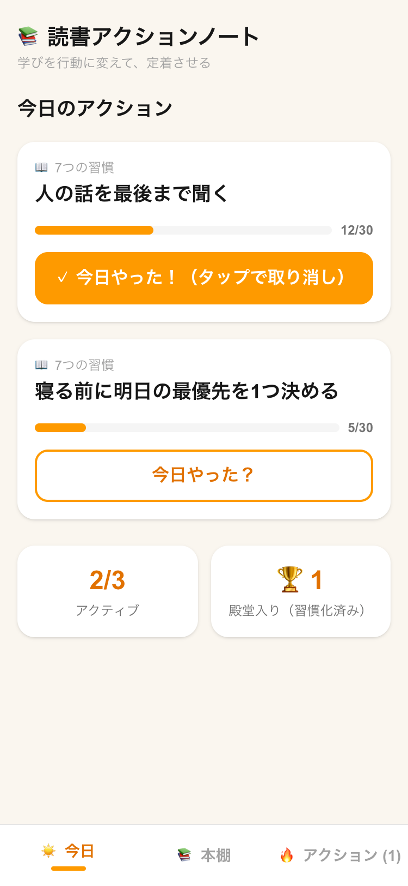
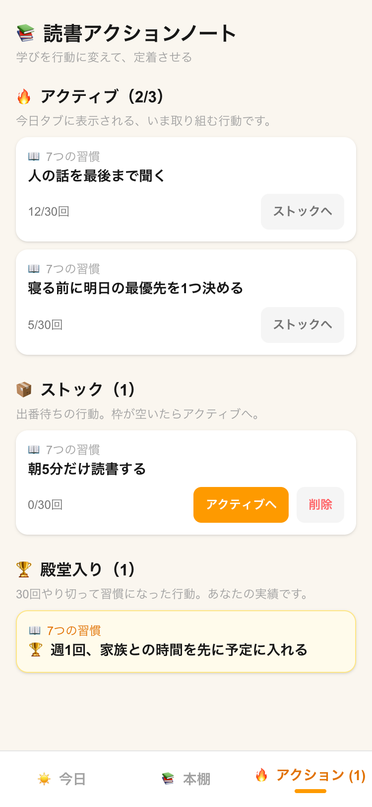

# 読書アクションノート

自己啓発書を「読んで終わり」にしないアプリ。
本ごとに気づきを記録し、行動に移すアクションを最大3個の「アクティブ枠」で毎日チェック。
30回実行したアクションは殿堂入りし、習慣化の実績として積み上がっていく。

**公開URL**: https://dokusho-action-note.vercel.app

## スクリーンショット

| 今日タブ | アクションタブ |
|---|---|
|  |  |

## 誰の・何を・どう解決するか

- **誰の**: 自己啓発書を読む人
- **何を**: 読んで「良い勉強になった」で終わり、行動に移らず内容も忘れる問題
- **どう**: 学びを「気づき」と「アクション」に分けて記録し、アクションは3個に絞って毎日チェック。実行回数が貯まる仕組みで定着させる

## 主な機能

- 本の登録（表紙はGoogle Books APIで自動取得。見つからなければ書名カード＋再取得ボタン）
- 気づきの無制限記録（「一言で言うと？」の短文形式）
- アクションの3状態管理: アクティブ（最大3個）／ストック／殿堂入り（30回実行で自動昇格）
- 「今日やった」チェックは1日1回。同日再タップで取り消し
- ログイン不要・localStorage保存・オフライン入力可

## 設計のポイント

- アクティブ枠を3個に制限することで「本を読むほどアクションが溢れる」問題を構造的に防ぐ
- ホーム（今日タブ）に表示するのは本棚ではなく「今日やる行動」。朝晩のチェックが3タップ以内で終わる
- 殿堂入りリストが「読書が行動に変わった証拠」として貯まり、続けるモチベーションになる

## 技術スタック

- Next.js 16 (App Router) / TypeScript / Tailwind CSS 4
- データ保存: localStorage（ログイン・DB不要）
- 表紙取得: Google Books API（APIキー不要）
- ホスティング: Vercel

## 開発

```bash
npm install
npm run dev
```

要件定義は [requirements.md](requirements.md) を参照。
